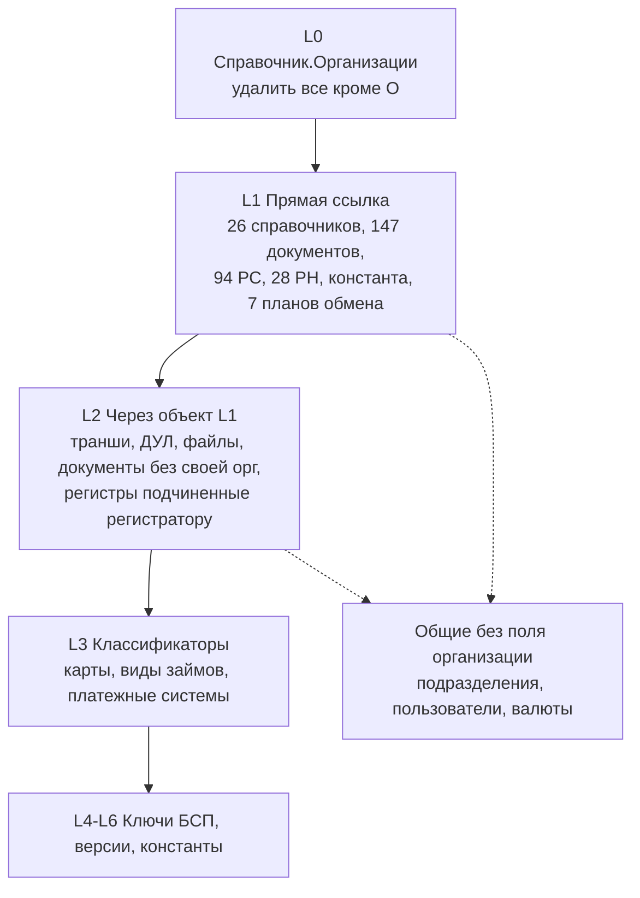

# Очистка ИБ ТБ: оставить одну организацию

Документ для сотрудника, который будет выполнять очистку на копии и на проде.

**Конфигурация:** основная ТБ (`Справочник.Организации` и связанные объекты `conf-main`).

**Источник анализа:** метаданные `repos/conf-main/src/cf` на 2026-08-20. Разобрано 2899 объектов. Прямая ссылка на организацию есть у 304 объектов. Общего реквизита-разделителя нет: организация всегда явное поле, измерение или владелец.

**Чего в документе нет:** скрипта удаления, оценок объема данных, правки RLS «под ключ». Объемы и смешанные записи нужно снять запросами на копии ИБ до первого удаления.

---

## 1. Постановка

В справочнике `Организации` остается **один** элемент. Обозначения:

| Символ | Смысл |
|---|---|
| `O` | Оставляемый элемент `Справочник.Организации` |
| `D` | Все остальные элементы этого справочника, они удаляются |

После очистки ни одно поле типа `CatalogRef.Организации` (включая `DefinedType.Организация`) не должно ссылаться на элемент из `D`.

Поля `МФО`, `Организация`, `Агент`, `Цедент`, `Истец`, `Получатель` и аналоги с тем же типом - это **один** справочник. `МФО` обычно юрлицо, `Организация` / `Агент` обычно офис. На живых данных значения часто разные.

---

## 2. Три корзины на каждую запись

На любой экземпляр (элемент справочника, документ, строка регистра) смотреть так:

| Корзина | Условие по ссылкам `CatalogRef.Организации` | Действие |
|---|---|---|
| Удалить | Все заполненные ссылки входят в `D` (включая владельца) | Удалить запись. Движения и присоединенные файлы уходят вместе с ней |
| Оставить | Все заполненные ссылки равны `O` либо пусты | Не трогать |
| Коллизия | Есть хотя бы одна ссылка = `O` и хотя бы одна из `D` | Нельзя ни удалить целиком, ни оставить. Заменить `D` на `O`, обнулить чужое поле или вырезать только чужие строки ТЧ |

Запись с **одним** полем организации режется однозначно: не `O` значит удалить. Коллизия только там, где на одном экземпляре одновременно `O` и `D`.

Простой отбор `ГДЕ Организация <> O` на объектах с двумя полями либо оставит ссылки на `D`, либо снесет данные `O`.

---

## 3. Граф уровней

Уровень - длина цепочки ссылок до `Справочник.Организации`. На каждом уровне сначала корзина «Удалить», затем коллизии, корзину «Оставить» не трогать.

Порядок на копии и на проде (от листьев к корню внутри корзины «Удалить»):

1. Регистры уровня 1 с **одним** измерением-организацией: удалить строки, где измерение в `D`.
2. Документы уровня 1 с **одним** полем: удалить, если шапка в `D`. Движения и файлы уйдут с регистратором.
3. Подчиненные справочники уровня 2: удалить, если владелец уже удален.
4. Справочники с владельцем `Организации`: кассы, ККТ, онлайн-кассы, настройки обмена НБКИ - владелец в `D` означает удалить.
5. Объекты с 2+ полями организации и общие справочники - только после разбора коллизий.
6. Элементы `Справочник.Организации` из `D`. Перед этим: константа `МФОДляОнлайнЗаймов` = `O`; из ТЧ планов обмена убрать строки с `D`; на самом `O` очистить/заменить самоссылки на `D`.

Регистры, подчиненные регистратору, отдельно по организации не фильтровать: они удаляются вместе с документом.

---

## 4. Что сделать до прода

1. Полный бэкап ИБ. Работа сначала на копии с тем же составом организаций.
2. Зафиксировать `O` (код, наименование, GUID) и список `D`. Согласовать, что делать в коллизиях: подмена `D` -> `O` или обнуление поля.
3. Запросами на копии посчитать смешанные записи по объектам из раздела «Коллизии». Без этих чисел на прод не идти.
4. Остановить регламентные задания, обмен (Ортикон, УПП, БП, Эскорт, универсальный формат), очереди БКИ/платежей.
5. Снять пользователей с работы. После очистки - тестирование кассы, выдачи, оплаты, печати, выгрузки БКИ.

Проверка после очистки: поиск ссылок на удаленные GUID организаций (технологический журнал / «поиск ссылок на объект» / запросы по всем полям из уровня 1). Битых `CatalogRef.Организации` быть не должно.

---

## 5. Уровень 0. Корень

Удаляются все элементы `Справочник.Организации`, кроме `O`. Иерархии нет.

У самого `O` поля `МФО` и `ПредставительВСуде` имеют тип организация. Если они указывают на элемент из `D`, это коллизия на корне: перед удалением `D` заменить на `O` или очистить.

Файлы `Справочник.ОрганизацииПрисоединенныеФайлы` с владельцем из `D` удаляются.

Регистр сведений `ПериодическиеРеквизитыОрганизаций` по измерению `O` может хранить `ПредставительВТретейскомСуде` из `D` - та же правка.

---

## 6. Уровень 1. Прямая ссылка

### 6.1. Справочники

| Объект | Поля / владелец | Действие |
|---|---|---|
| Кассы | владелец Организации | Удалить, если владелец в `D` |
| КассовыеАппараты | владелец Организации | Удалить, если владелец в `D` |
| УчетныеЗаписиОнлайнКасс | владелец Организации | Удалить, если владелец в `D` |
| НастройкиОбменаСНБКИ | владелец Организации | Удалить, если владелец в `D` |
| ДоговорыКонтрагентов | МФО + Организация; владелец Контрагенты | Удалить, если оба поля в `D`. Смесь `O` и `D` - коллизия |
| Контрагенты | МФО | МФО в `D` - удалить карточку. Офис в РС ПодразделенияКонтрагентов может дать коллизию |
| БанковскиеСчета | МФО + Организация | Смесь `O` и `D` на двух полях - коллизия |
| ДоговорыАгентов | Агент | Удалить по агенту в `D` |
| ДоговорыРекламы | Организация; владелец Поставщики | Удалить по организации, поставщика оставить |
| ДоговорыПередачиПоЦессии | Цедент | Цедент может быть организацией |
| ПрограммыСтрахования | ОрганизацияСтрахования; владельцы СтраховыеКомпании, Поставщики | Чистить программы, не владельцев |
| СтраховыеКомпании | Организация | Проверить, не общая ли компания для `O` |
| ЭлектронныеКошельки | Организация; владелец Контрагенты | Кошелек клиента конкретной орг |
| ВнешниеСистемы | Организация | Фильтровать; система может быть общей |
| Пользователи | ОсновнаяОрганизация | Не удалять. Если поле в `D` - поставить `O` |
| ФизическиеЛица | Организация | Удалять только если нет ссылок из графа `O` |
| ПР_УчетныеЗаписи | Организация | Удалить чужие |
| СобытияКредитнойИстории | Организация | Удалить чужие |
| СтадииОбработкиОбъектов | Организация | Проверить, не общие ли стадии |
| НастройкаСоответствияБанковскихСчетовИПлатежныхСистем | Организация | Удалить чужие |
| НастройкиАвтоматическоеОдобрениеЗаявокНаВыдачуЗайма | Организация только в 3 ТЧ | Элемент оставить, строки ТЧ с `D` вычистить |
| НастройкиПрограммногоИнтерфейса | ТЧ СвязиПространстваАвторизации: Организация + МФО | Строки ТЧ |
| НастройкиРаботыСБанковскимиВыписками | ТЧ ОрганизацииАвтоматическогоПолученияВыписок | Строки ТЧ |
| НастройкиРасчетаПДН | ДополнительнаяОрганизацияДляПолученияОтветаБКИ | Поле-коллизия, не шапка |
| НастройкиСогласияНаОбработкуПерсональныхДанных | ТЧ СписокМФО | Строки ТЧ |

### 6.2. Документы

Документ с одним полем: шапка в `D` - удалить. Документ с МФО и Организацией: удалить только если оба в `D`; если одно поле равно `O`, а другое в `D` - коллизия.

#### Займы, расчеты, конвейер

| Документ | Поля организации |
|---|---|
| ЗаявкаНаВыдачуЗайма | МФО + Организация |
| ИзменениеУсловийДоговораЗайма | МФО + Организация |
| КорректировкаЗайма | Организация; ТЧ НачисленияБУ.МФО/Агент |
| ВыдачаЧерезПлатежнуюСистему | Агент + МФО |
| ОплатаЧерезПлатежнуюСистему | МФО + Организация |
| ПередачаДоговоровМеждуАгентами | МФО, АгентСтарый, АгентНовый, МФОНовая |
| ПереносПредоплатыПоДоговорамЗайма | Организация |
| РефинансированиеСобственногоДоговора | Организация |
| РефинансированиеТраншаКредитнойЛинии | Организация |
| НачислениеПоРегламентированномуУчету | МФО + Агент |
| ОтражениеОперацийПоЗаймамВБУ | Организация; ТЧ Данные.МФО/Агент |
| КорректировкаПоРегламентированномуУчету | ТЧ Начисления.МФО/Агент |
| РасчетРезервов | МФО + Агент |
| РасчетФинансовогоЗдоровья | Организация |
| РасчетЕжемесячногоПлатежа | Организация |
| РасчетМакропруденциальногоЛимита | МФО |
| ПределыМПЛ | Организация |
| СегментыПДН | Организация |
| ИндивидуальныеПризнакиОбесценения | Организация |
| ИнвентаризацияБезнадежнойЗадолженности | Организация |
| ПризнаннаяЗадолженность | Организация |
| СписаниеПризнаннойЗадолженности | Организация |
| ОспариваниеЗаключенияДоговораЗайма | Организация |
| УстановкаПризнакаПревышениеМПЛ | Организация |
| УстановкаРыночныхСтавокЭСП | Организация |
| УстановкаНастройкиРасчетаФинансовойНагрузки | МФО |
| ДетальнаяНастройкаКредитныйКонвейер | Организация |
| ДетальнаяНастройкаПодтверждениеДоходаКлиентов | Организация |
| ДетальнаяНастройкаПодтвержденияДеятельностиИПСЗ | Организация |
| ДетальнаяНастройкаПредварительныйЗапросКредитнойИстории | Организация + ОрганизацияПредварительный |
| НастройкиМакропруденциальныхЛимитов | Организация |
| НастройкиРасчетаПДН | Организация |
| НастройкиМодельДоходаКлиентов | Организация |
| НастройкиЕжемесячныйПлатеж | Организация |
| НастройкиДоступностиРефинансированияПлатежаПоТраншу | Организация |

#### Доппродукты и страхование

| Документ | Поля организации |
|---|---|
| ДоговорГарантииМГС | МФО + Организация |
| ДоговорДополнительногоПродуктаPharmIQ | МФО + Организация |
| ДоговорДополнительногоПродуктаГарантияОстановкиПроцентов | МФО + Организация |
| ДоговорДополнительногоПродуктаГололед | МФО + Организация |
| ДоговорДополнительногоПродуктаЖара | МФО + Организация |
| ДоговорДополнительногоПродуктаЗащитаКарты | МФО + Организация |
| ДоговорДополнительногоПродуктаИФЛ | МФО + Организация |
| ДоговорДополнительногоПродуктаМультиСертификат | МФО + Организация |
| ДоговорДополнительногоПродуктаПоручительство | МФО + Организация |
| ДоговорДополнительногоПродуктаПсихолог | МФО + Организация |
| ДоговорДополнительногоПродуктаСберЗдоровье | МФО + Организация |
| ДоговорДополнительногоПродуктаСтрахованиеОтПотериРаботы | МФО + Организация |
| ДоговорДополнительногоПродуктаФЗ | МФО + Организация |
| ДоговорДополнительногоПродуктаФЗИФЛ | МФО + Организация |
| ДоговорДополнительногоПродуктаЮрист | МФО + Организация |
| ДоговорДополнительнойУслугиАнтиклещ | МФО + Организация |
| ДоговорДополнительнойУслугиСтрахованиеОтCOVID_19 | МФО + Организация |
| ДоговорДополнительнойУслугиТеледоктор | МФО + Организация |
| ДоговорСтрахованияИФЛ | МФО + Организация |
| ДоговорСтрахованияОтНС | МФО + Организация |
| ОтчетПоСтрахованиюОтНС | МФО + Организация |
| ЗаключениеДоговораСНПФ | Организация |
| РеестрДоговоровНПФ | Организация |

#### Касса, банк, подотчет

| Документ | Поля организации |
|---|---|
| ПриходныйКассовыйОрдер | Организация |
| РасходныйКассовыйОрдер | Организация |
| КассовыйЧек | МФО + Организация |
| КассовыеСмены | Организация |
| АктРевизииПоКассе | Организация |
| ПрочаяКассоваяОперация | Организация |
| БанковскаяВыписка | Организация |
| ВнесениеНаРасчетныйСчет | Организация |
| ПлатежноеПоручениеВходящее | Организация |
| ПлатежноеПоручениеИсходящее | МФО + Организация |
| РеестрКассовыхЧековКоррекции | Организация |
| РеестрОплатЧерезПлатежныеСистемы | Организация |
| АвансовыйОтчет | Организация |
| ЗаявкаНаПереводДенежныхСредств | Организация |
| ЗаявкаНаПолучениеДенежныхСредствПодОтчет | Организация |
| ЗаявлениеНаВыдачуДенегПодОтчет | Организация |
| ЗаявкаНаРекуррентныйПлатеж | Организация |
| ПереводЧерезПлатежнуюСистемуСотрудникам | Организация |
| КорректировкаСобственныхНаличныхДенежныхСредств | ТЧ ДенежныеСредства.Организация |
| РеквизитыПолученияДенег | Организация |
| ПополнениеМобильногоНомера | Организация |
| УстановкаБанковскихСчетовППИПоДопПродуктам | Организация + ОрганизацияПолучатель |
| НастройкаПереводыДенежныхСредств | Организация |
| НастройкаСпособовПеречисленияДенежныхСредств | Организация |
| НастройкаИнтеграцииЭлектронныхКошельков | ТЧ НастройкиПоОрганизациям |
| НастройкаИнтеграцияССБП | ТЧ НастройкиПоОрганизациям |
| НастройкаИнтеграцияСервисЭлектронныхСредствПлатежей | Организация |
| НастройкаФормированияКассовыхЧековПоступленияПроцентовПоЗаймам | Организация |
| НастройкаКонтроляЗаполненияППИ | Организация + Получатель |

#### Клиенты, согласия, обращения

| Документ | Поля организации |
|---|---|
| АСПКонтрагента | МФО |
| ЗаявкаНаАСП | МФО |
| СогласиеНаЗапросКредитнойИстории | Организация |
| УстановкаСогласийКлиента | МФО |
| ОформлениеКлиентскойКарты | МФО |
| СменаПодразделенияКонтрагентов | ТЧ РезультатЗамены.МФО/Организация |
| ГрупповоеСоглашение | Организация |
| ЖалобаКлиента | Организация |
| Обращение | Организация |
| КорректирующиеКоэффициентыДоходаКонтрагента | Организация |
| НастройкиВыбораВидаПроверкиСервисаПроверкиКонтрагентов | Организация |

#### Взыскание, суд, БКИ, цессия

| Документ | Поля организации |
|---|---|
| НБКИВыгрузка | Организация |
| ОтветНБКИ | Организация |
| ОтправкаВБКИ | Организация |
| ЗапросИнформацииОБанкротстве | ТЧ ОрганизацииВКредиторах |
| ДоговорНаПредставлениеВСуде | Организация + Истец |
| НастройкиСудебногоВзыскания | Организация + ТЧ для ФССП |
| ПокрытиеСудебныхИздержек | Организация |
| РегистрацияСудебныхИздержек | Организация |
| РеестрОплатПоПроданнымДоговорамЦессии | Организация |
| КомплектДокументовДляОтправки | Организация |
| ФормыДокументов | Организация |
| ПакетЗаявленийМВД | Организация |
| ПротоколДопроса | Организация |
| Инцидент | Организация |
| ЗалогИмущества | Организация |

#### Кадры, мотивация, ТМЦ

| Документ | Поля организации |
|---|---|
| ГрафикОтпусков | Организация |
| Табель | Организация |
| ЗарплатаКВыплате | Организация |
| НачислениеЗаработнойПлаты | Организация |
| НачислениеБалловСотруднику | Организация |
| СнятиеБалловСотруднику | Организация |
| НачислениеБалловПоРезультатамПроверкиОтделаУправленияКачеством | ТЧ СписокПроверок.Организация |
| СогласованиеБалловСотрудникам | Организация |
| СогласованиеНачисленийБалловОтделаУправленияКачеством | Организация |
| РасчетПоказателейЗаработнойПлаты | ПредметРасчета, УдалитьОрганизация, ТЧ Организация/ОрганизацияСтрахование |
| Командировка | Организация |
| ЗапросСправкиСотрудником | Организация |
| НазначениеОтветственныхЛицПодразделений | Организация |
| СлужебнаяЗаписка | Организация |
| СлужебнаяЗапискаОДепремировании | Организация |
| УдержаниеКомиссионнойЧастиСотрудника | Организация |
| АктПроверкиДоговоров | Организация |
| АктПроверкиДоговоровДляУдержанияКомиссионнойЧасти | Организация |
| ПриказОПроведенииПроверки | Организация |
| ГрафикПлатежей | Организация |
| ВыдачаПодарка | Организация |
| Розыгрыш | Организация |
| ИнвентаризацияНоменклатуры | Организация |
| ПередачаНоменклатуры | Организация + ОрганизацияРасходы |
| ПеремещениеМатериаловВЭксплуатации | Организация |
| ПродажаМатериаловИзЭксплуатации | Организация |
| СписаниеМатериаловИзЭксплуатации | Организация |
| СтандартноеОснащение | Организация |
| УчетБумаги | Организация |
| УстановкаСтоимостиПачкиБумаги | Организация |
| ОтправкаГруза | Организация |
| ОтражениеГоспошлин | Организация |
| РегистрацияПрочихДоходов | Организация |
| ИзменениеСтатусаХраненияДокументов | Организация |

### 6.3. Регистры накопления

| Регистр | Измерения организации |
|---|---|
| Банк | Организация |
| Касса | Организация |
| КассовыеЧеки | Организация |
| СобственныеНаличныеДенежныеСредства | Организация |
| ДеньгиВПутиУСотрудников | Организация |
| ВзаиморасчетыСПодотчетнымиЛицами | Организация |
| Затраты | Организация |
| ЗарплатаКВыплате | Организация |
| ОстаткиБумаги | Организация |
| УчетГоспошлин | Организация |
| РеестрыОплатЧерезПлатежныеСистемы | Организация |
| ОборотПоПлатежнымСистемам | Организация + МФО |
| БезнадежнаяЗадолженность | Организация |
| ВзаиморасчетыПоУчетуПотерь | Организация |
| ЗалогиПоЗаймам | Организация |
| РасчетыПоЗаймамБУ | МФО + Агент |
| РасчетыПоЗаймамБУ_ТЕСТ | МФО + Агент |
| РасчетыПоРезервам | МФО + Агент |
| РасчетыПоРезервамПодОбесценение | МФО + Агент |
| КорректировкиПоЗаймамБУ | МФО + Агент |
| РасчетыПоЗаймамЦессии | МФО |
| РасчетыПоСудебнымРешениям | МФО |
| ПредоплатыПоДоговорамЗаймаБУ | МФО |
| МакропруденциальныеЛимиты | МФО |
| МакропруденциальныеЛимитыПоГруппам | МФО |
| МакропруденциальныеЛимитыПоКатегориям | МФО |
| СтрахованиеИФЛ | МФО |
| СтрахованиеОтНС | МФО |

Регистры с двумя измерениями (`МФО` + `Агент` / `Организация` + `МФО`) - коллизии, см. раздел 8.

### 6.4. Регистры сведений

| Регистр | Поля организации |
|---|---|
| АСПКонтрагента | МФО |
| ОПДКонтрагента | МФО |
| ВыбранныеСогласияКлиентов | МФО |
| ПолученныеСогласияКлиентов | МФО |
| ПервыеДоговорыЗаймаВРазрезеМФО | МФО |
| КонтрагентыМФО | МФО |
| ПодразделенияКонтрагентов | МФО + Организация |
| ПринадлежностьДоговоров | Организация + МФО |
| ОрганизацииНаПодразделениях | 7 ресурсов-организаций |
| ИсторияКонтрагентов | Организация |
| ВерификацияКонтрагентов | Организация |
| СогласиеНаЗапросКредитнойИстории | Организация |
| ОчередьРекуррентныхПлатежей | МФО |
| РезультатыРекуррентныхПлатежей | МФО |
| НастройкиБКИ | Организация |
| НБКИ | Организация |
| ОтветыНБКИ | Организация |
| ДатыОтправкиНБКИ | Организация |
| ОчередьВыгрузкиВНБКИ | Организация |
| ОчередьЗапросовВНБКИ | Организация |
| СостоянияОтправкиВБКИ | Организация |
| ОчередьФормированияСобытийКредитнойИстории | Организация |
| АналитикаЗапросовКредитнойИстории | Организация |
| ИсторияЗаймовДругихОрганизаций | Организация |
| ПериодическиеРеквизитыОрганизаций | Организация + ПредставительВТретейскомСуде |
| ПериодичностьОрганизацийПоВидуМФО | Организация |
| ОтветственныеЛица | Организация + СубъектПредставительства |
| ОтветственныеЛицаПодразделений | Организация |
| ДоверенностиПользователей | Организация |
| ГрафикОтпусков | Организация |
| КэшОстаткиОтпусков | Организация |
| НастройкиБанковскихСчетовППИПоДопПродуктам | Организация + ОрганизацияПолучатель |
| НастройкиПлатежейНаВозвратДенежныхСредств | Организация, ОрганизацияКтоДелаетВозврат, ОрганизацияКомуОплатили |
| НастройкиКонтроляЗаполненияППИ | Организация + Получатель |
| НастройкиОперацийПоБанковскимКартам | Организация |
| НастройкиПереводыДенежныхСредств | Организация |
| НастройкиФормированияQRКодов | Организация |
| ИдентификаторыОрганизацийДляВерификацииТелефонов | Организация |
| ИдентификаторыОрганизацийДляСервисаМаршрутизацииПлатежей | Организация |
| ИдентификаторыБанковскихКартДляПлатежныхСистем | МФО |
| НомераЛистовКассовойКниги | Организация |
| СтоимостьПачкиБумаги | Организация |
| ПодобранныеРешения | Организация |
| ДетальныеНастройкиКредитныйКонвейер | Организация |
| НастройкиРасчетаПДН | Организация |
| СегментыПДН | Организация |
| ПределыМПЛ | Организация |
| РыночныеСтавкиЭСП | Организация |
| ПроцентыРезервированияДляРО | МФО |
| РискиВозникновенияУбытков | МФО |
| УступкаПравТребований | МФО |
| ПереданныеДоговорыЦессии | Цедент |

Полный список уровня 1 по метаданным шире этой таблицы (94 РС). Если регистра нет в таблице, искать измерение/ресурс типа `CatalogRef.Организации` и применять те же три корзины.

### 6.5. Константа и планы обмена

| Объект | Как связан |
|---|---|
| Константа.МФОДляОнлайнЗаймов | Значение = организация. Поставить `O`, иначе битая ссылка |
| ПланОбмена.ОбменЗаймыУправлениеПроизводственнымПредприятием | ТЧ Организации.Организация |
| ПланОбмена.ОбменТБАудитЭскорт | ТЧ Организации.Организация |
| ПланОбмена.ОбменТББухгалтерияПредприятия | ТЧ Организации.Организация |
| ПланОбмена.ОбменТБОртикон | ТЧ Организации.Организация |
| ПланОбмена.ОбменТБОртиконНачисления | ТЧ Организации.Организация |
| ПланОбмена.ОбменТБОртиконНеоперативный | ТЧ Организации.Организация |
| ПланОбмена.СинхронизацияДанныхЧерезУниверсальныйФормат | ТЧ Организации.Организация |

Узлы обмена не удалять. Из ТЧ убрать строки с организацией из `D`.

---

## 7. Уровень 2. Через объект уровня 1

Наивный обход графа дает 747 объектов. Из них 83 справочника, 62 документа и 93 регистра попадают сюда только через `Справочник.Пользователи.ОсновнаяОрганизация`. Это не признак принадлежности данных организации. Пользователей из-за этого не удалять.

### 7.1. Удалять вместе с владельцем

- Подчинение `ДоговорыКонтрагентов`: `ТраншиКредитныхЛиний`, `СчетаАналитическогоУчета`.
- Подчинение `Контрагенты`: `ДокументыУдостоверяющиеЛичностьКонтрагента`.
- Присоединенные файлы документов и справочников уровня 1 (~35 каталогов `*ПрисоединенныеФайлы`), плюс `РаспечатанныеФормыОбъектов`.
- Реквизиты заявки: `ДополнительныеРеквизитыПДН`, `ДополнительныеРеквизитыПереоформление`, `ДополнительныеРеквизитыРефинансирования`, `ДополнительныеРеквизитыДополнительногоПродукта`, `ОплатаПредставителем`.

### 7.2. Документы без своей организации

Удалять, если ведущий объект (договор / контрагент / касса) уже в корзине «Удалить». Если ведущий объект - коллизия, документ тоже разбирать вручную.

**Через договор:** Анкета, ВнебалансовыеДоговорыКонтрагентов, ЗапросDebex, ИсполнительныйЛист, КорректировкаПризнаковДоговораРегл, НачислениеПоДоговору, НачислениеСписаниеПоИсполнительномуДокументу, ПодписьДокумента, ПроверкаОСБ, РаспознаваниеИсполнительныхЛистов, УведомлениеОХодеИсполнительногоПроизводства, КредитнаяЛиния, ДосрочныеПогашения, ОнлайнЗаявка, ОтменаДополнительногоПродукта, РасчетПоказателяДолговойНагрузки.

**Через контрагента:** ВизитОсмотр, Встреча, ВыдачаДисконтнойКарты, ВозвратКартыОтКлиента, ЖалобаВОтделСудебныхПриставов, ЗапросВФССП, ПодтверждениеДоходаКлиента, ПредварительноОдобренныеЗаймы, СогласиеНаРекуррентныйПлатеж, УстановкаСнятиеБлокировки, УстановкаУровняКлиента, ПроверкаКлиентов.

**Через кассу:** УстановкаКассовыхЛимитов.

### 7.3. Регистры, подчиненные регистратору уровня 1

Своей организации нет. Удаляются при удалении документа. Ключевые по займам:

| Регистр | Тип | Типичные регистраторы |
|---|---|---|
| СостояниеДоговоровЗайма / СостояниеКонтрагентов | РС | Выдача/оплата через ПС, ПКО, ПП входящее, КорректировкаЗайма, ИзменениеУсловий |
| ТекущиеУсловияДоговоровЗайма, УсловияДоговоровЗайма, УсловияДоговоровКредитнойЛинии, УсловияТраншейКредитнойЛинии | РС | ИзменениеУсловийДоговораЗайма |
| РасчетыПоЗаймам, РасчетыПоТраншам, РасчетыПоПросрочке, ВзаиморасчетыПоЗаймам | РН | Касса, банк, ПС, корректировка займа |
| СостоянияДополнительныхПродуктов / УсловияДополнительныхПродуктов | РС | Документы ДоговорДополнительногоПродукта* |
| БанковскиеКартыКлиентов, БанковскиеКартыНаПодразделениях | РС | ОформлениеКлиентскойКарты |

Таких регистров по метаданным 61. Не фильтровать их по организации отдельно от документа.

---

## 8. Уровни 3-6

Классификаторы, на которые ссылаются договоры, заявки и касса, но своей организации нет. Элемент целиком не удалять: его могут использовать и `O`, и документы из `D`.

| Объект | Почему уровень 3 | Действие |
|---|---|---|
| Справочник.БанковскиеКарты | Ссылки из заявки, оформления карты, ПП исходящее | Удалять карты клиентов чужих МФО; корпоративные - по подразделению |
| Справочник.ВидыЗаймов / ТипыВидовЗайма | Настройки конвейера и заявок | Оставить |
| Справочник.ПлатежныеСистемы | Обороты по ПС, кошельки, выписки | Оставить. Вычистить только движения чужих организаций |
| Справочник.ПоказателиСхемМотивации | Через расчет зарплаты | Оставить классификатор |

Уровни 4-6: константы, ключи доступа БСП (`ЗначениеДоступа`, `ВладелецЗначенийКлючейДоступа`), `ВерсииОбъектов`. Не удалять объекты целиком: чистить ключи и версии по уже удаленной ссылке.

Вне графа ~1600 объектов без пути к организации (перечисления, общие классификаторы, обработки). Их не трогать.

---

## 9. Коллизии

Коллизия = на одном экземпляре есть ссылка на `O` и ссылка на элемент из `D`. После удаления `D` оставшаяся ссылка станет битой. Если запись удалить целиком, пропадут данные `O`.

### 9.1. Несколько ссылок на Организации в одном экземпляре

| Объект | Поля | Когда запись в корзине «Коллизия» |
|---|---|---|
| Справочник.ДоговорыКонтрагентов | МФО + Организация (владелец Контрагенты) | МФО = `O`, а Организация в `D` (или наоборот) |
| Справочник.Контрагенты | МФО | Одно поле: МФО в `D` - удалить. Офис в РС ПодразделенияКонтрагентов может быть другим элементом |
| Справочник.БанковскиеСчета | МФО + Организация | Одно поле = `O`, другое в `D` |
| Документ.ЗаявкаНаВыдачуЗайма, ИзменениеУсловийДоговораЗайма, КассовыйЧек, ПлатежноеПоручениеИсходящее | МФО + Организация | Шапка офиса = `O`, МФО в `D` (типично, если `O` - офис, а юрлицо удаляют) |
| РН РасчетыПоЗаймамБУ, РасчетыПоРезервам, КорректировкиПоЗаймамБУ | МФО + Агент | Одно измерение = `O`, второе в `D`. Удалять строку нельзя |
| РН ОборотПоПлатежнымСистемам | Организация + МФО | То же |
| РС ПринадлежностьДоговоров | Организация + МФО (ресурсы) | Договор «принадлежит» `O` по одному ресурсу и элементу из `D` по другому |
| РС ПодразделенияКонтрагентов | МФО + Организация (ресурсы) | Клиент оставляемого МФО сидит в офисе из `D`, или наоборот |

Тот же дубль МФО + Организация на всех документах `ДоговорДополнительногоПродукта*`, `ДоговорСтрахования*`, `ДоговорГарантииМГС`, `ВыдачаЧерезПлатежнуюСистему`, `ОплатаЧерезПлатежнуюСистему`, `ОтчетПоСтрахованиюОтНС`.

Всего объектов с 2+ полями типа организация: 61.

### 9.2. Кросс-организационные операции

Один документ связывает две разные организации как стороны. Удаление «чужой» стороны ломает документ `O`.

| Объект | Стороны | Правило |
|---|---|---|
| Документ.ПередачаДоговоровМеждуАгентами | МФО, АгентСтарый, АгентНовый, МФОНовая | Править, если хотя бы одно поле = `O`, остальные в `D`. Удалить, только если все четыре в `D` |
| Документ.ПередачаНоменклатуры | Организация + ОрганизацияРасходы | Две фирмы в одном перемещении ТМЦ |
| Документ.УстановкаБанковскихСчетовППИПоДопПродуктам / РС НастройкиБанковскихСчетовППИПоДопПродуктам | Организация + ОрганизацияПолучатель | Плательщик и получатель доппродукта |
| РС НастройкиПлатежейНаВозвратДенежныхСредств | Организация, ОрганизацияКтоДелаетВозврат, ОрганизацияКомуОплатили | Возврат может делать не та организация, которая принимала платеж |
| РС НастройкиКонтроляЗаполненияППИ | Организация + Получатель | Получатель тоже `CatalogRef.Организации` |
| Документ.ДоговорНаПредставлениеВСуде | Организация + Истец | Истец - другая организация |
| Документ.ДетальнаяНастройкаПредварительныйЗапросКредитнойИстории | Организация + ОрганизацияПредварительный | Основной и предварительный запрос КИ |
| РС НастройкиПечатиДляДокументооборотаПоБанковскимКартам | УправляющаяОрганизация + ОрганизацияДоговора | Управляющая компания и организация договора |

### 9.3. Одна шапка, несколько организаций в ТЧ

| Объект | Шапка | ТЧ | Коллизия |
|---|---|---|---|
| КорректировкаЗайма | Организация | НачисленияБУ.МФО, НачисленияБУ.Агент | Строки ТЧ могут быть по другим МФО/агентам, чем шапка |
| ОтражениеОперацийПоЗаймамВБУ | Организация | Данные.МФО, Данные.Агент | Пакетный документ на несколько офисов |
| КорректировкаПоРегламентированномуУчету | нет | Начисления.МФО, Начисления.Агент | Набор чужих и своих строк |
| НастройкиСудебногоВзыскания | Организация | ОрганизацииДляПроверкиЗапросовФССП | Список юрлиц для ФССП шире шапки |
| РасчетПоказателейЗаработнойПлаты | ПредметРасчета, УдалитьОрганизация | Подразделения.Организация + ОрганизацияСтрахование | Одна ведомость по нескольким офисам |
| СменаПодразделенияКонтрагентов | нет | РезультатЗамены.МФО + Организация | Документ как раз про смену офиса/МФО |
| ЗапросИнформацииОБанкротстве | нет | ОрганизацииВКредиторах | В списке кредиторов несколько организаций ТБ |
| КорректировкаСобственныхНаличныхДенежныхСредств | нет | ДенежныеСредства.Организация | Одна корректировка по нескольким кассовым организациям |

Правило: шапка в `D` и все строки ТЧ в `D` - удалить документ. Шапка = `O`, в ТЧ есть `D` - удалить только чужие строки. Шапка в `D`, в ТЧ есть `O` - не удалять документ, переставить шапку на `O` или вынести строки `O`.

### 9.4. Элемент без организации, организации только в ТЧ

Один элемент настройки обслуживает много организаций. Удалять элемент нельзя: вычищать строки ТЧ, где организация в `D`.

| Объект | ТЧ |
|---|---|
| Справочник.НастройкиАвтоматическоеОдобрениеЗаявокНаВыдачуЗайма | Три ТЧ с Организацией: отбор, одобрение, маршрутизация |
| Справочник.НастройкиПрограммногоИнтерфейса | СвязиПространстваАвторизации: Организация + МФО в одной строке |
| Справочник.НастройкиРаботыСБанковскимиВыписками | ОрганизацииАвтоматическогоПолученияВыписок |
| Справочник.НастройкиСогласияНаОбработкуПерсональныхДанных | СписокМФО |
| Документы НастройкаИнтеграцииЭлектронныхКошельков / НастройкаИнтеграцияССБП | НастройкиПоОрганизациям |
| 7 планов обмена | ТЧ Организации |

### 9.5. Общие объекты: один элемент на много организаций

У объекта нет однозначной принадлежности к `D`, но на него ссылаются документы разных организаций. Удаление элемента даст битые ссылки у `O`.

| Объект | Входов из орг-объектов | Как чистить |
|---|---|---|
| Справочник.Подразделения | 132 | Не удалять. Связь - РС ОрганизацииНаПодразделениях. Подразделение оставить, если оно есть у `O` |
| Справочник.Пользователи | ОсновнаяОрганизация + Автор почти везде | Не удалять. Переставить ОсновнаяОрганизация на `O`. Группы доступа и RLS - отдельно |
| Справочник.ФизическиеЛица | реквизит Организация + кадровые документы | Клиенты - это Контрагенты. Не удалять физлицо, пока на него ссылается пользователь/кадры графа `O` |
| Справочник.Контрагенты | МФО на карточке | Один клиент = одно МФО. Нельзя удалить клиента `O` только потому, что он обслуживался в офисе из `D` |
| КаналыПродаж, ДополнительныеПродукты, ВидыНачислений, СпособыВключенияВТелоЗайма, Валюты, Номенклатура | 18-30 | Общие классификаторы. Не удалять |
| Поставщики / ПоставщикиБКИ / ПоставщикиКарт | 7-14 | Поставщик общий. Чистить договоры/программы, не поставщика |
| БанковскиеКарты | 10 | Карта клиента может участвовать в заявках разных офисов одного МФО |

### 9.6. Регистр ОрганизацииНаПодразделениях

Измерение - подразделение. Ресурсы (все `CatalogRef.Организации`):

- МФО
- ОрганизацияАгент
- ОрганизацияРасходы
- ОрганизацияРеклама
- ОрганизацияСтрахование
- ОрганизацияСтрахованиеЛК
- ОрганизацияРасходыДополнительная

Строка, где часть ресурсов = `O`, а часть в `D` - коллизия: целиком не удалять. Ресурсы из `D` обнулить или заменить на `O`, не оставив обязательные МФО/Агент пустыми. Строка, где все ресурсы в `D`, удаляется.

### 9.7. Составные типы

| Определяемый тип | Состав | Что делать |
|---|---|---|
| Цессионарий | Поставщики \| Организации | ДоговорыПередачиПоЦессии.Цедент и РС ПереданныеДоговорыЦессии. Если значение из `D` - обнулить или заменить |
| ВладелецПрисоединенныхФайлов | 63 типа, включая Организации | Удалить файлы, чей владелец из `D` |
| ЗначениеДоступа / ВладелецЗначенийКлючейДоступа | RLS БСП | Ключи доступа по организации. Чистить после удаления, иначе останутся ключи на битые ссылки |
| ВерсионируемыеДанные | 290 типов | РС ВерсииОбъектов: версии удаленных документов/справочников |

---

## 10. Сводка

| Ситуация | Удалять объект? | Что сделать |
|---|---|---|
| Все заполненные ссылки в `D` | Да | Удалить запись вместе с движениями и файлами |
| Все заполненные ссылки = `O` либо пусто | Нет | Оставить как есть |
| Есть ссылка = `O` и есть ссылка в `D` | Нет | Заменить `D` на `O`, обнулить чужое поле или удалить только чужие строки ТЧ |
| Нет своей организации, ссылки и от `O`, и от `D` | Нет | Оставить элемент. Удалить только когда не останется ссылок из графа `O` |
| ТЧ со списком организаций | Элемент нет, строки с `D` да | Удалить строки ТЧ, где организация в `D`; строки с `O` оставить |
| Пользователи, подразделения, валюты, виды займов, каналы продаж | Нет | Переставить ОсновнаяОрганизация на `O`. В ОрганизацииНаПодразделениях вычистить ресурсы из `D` |

---

## 11. Минимальный набор запросов на копии до удаления

По каждому объекту из раздела 9 посчитать число записей:

1. Все поля организации в `D`.
2. Все поля = `O`.
3. Смесь `O` и `D`.

Без третьей цифры объем ручной работы неизвестен. Особенно критичны:

- `Справочник.ДоговорыКонтрагентов`
- `Документ.ЗаявкаНаВыдачуЗайма`
- `РегистрНакопления.РасчетыПоЗаймамБУ`
- `РегистрСведений.ОрганизацииНаПодразделениях`
- `РегистрСведений.ПодразделенияКонтрагентов`
- `Документ.ПередачаДоговоровМеждуАгентами`
- самоссылки на элементе `O` (`МФО`, `ПредставительВСуде`)
