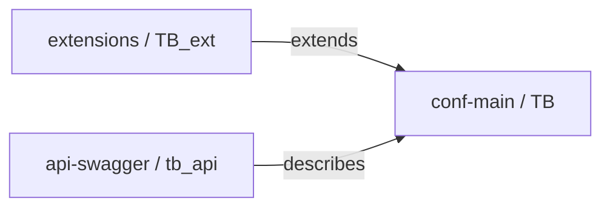

# Индекс репозиториев

Реестр: [repos/manifest.yaml](../../repos/manifest.yaml).

| id | В чате | GitLab | Локально |
|----|--------|--------|----------|
| `conf-main` | **TB**, **ТБ** | [1c/TB](https://gitlab.centrofinans.ru/1c/TB) | `repos/conf-main/` |
| `extensions` | **TB_ext**, расширения | [1c/TB_ext](https://gitlab.centrofinans.ru/1c/TB_ext) | `repos/extensions/` |
| `api-swagger` | **tb_api**, swagger | [1c/tb_api](https://gitlab.centrofinans.ru/1c/tb_api) | `repos/api-swagger/` |

## Связи

## Кросс-репозиторные задачи

Порядок по умолчанию: **TB** → **TB_ext** → **tb_api**.
